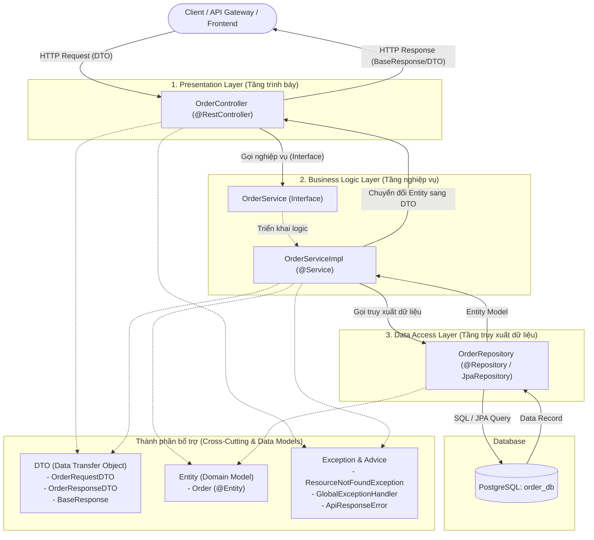
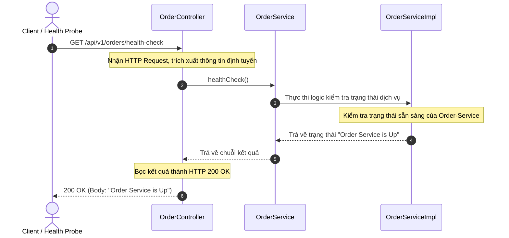

# TÀI LIỆU THIẾT KẾ: CHUẨN HÓA CẤU TRÚC THƯ MỤC & QUY TẮC ĐẶT TÊN
## Dự án: Order-Service (E-Commerce System)

---

## 1. TỔNG QUAN & BỐI CẢNH

### 1.1. Thực trạng & Vấn đề (Anti-Pattern)
- Trong giai đoạn đầu phát triển, nhiều dự án gặp phải lỗi kiến trúc phổ biến: **"Fat Controller"** hoặc **"Single Package Chaos"** – toàn bộ logic nhận request, xác thực dữ liệu, tính toán nghiệp vụ, và câu lệnh SQL/JPA đều bị dồn vào package `controller`.
- **Hệ quả tiêu cực**:
  - Vi phạm nghiêm trọng nguyên lý **Single Responsibility Principle (SRP)** trong SOLID.
  - Khó kiểm thử tự động (Unit Test / Integration Test), không thể mock dữ liệu độc lập.
  - Khó phân chia công việc cho nhiều lập trình viên cùng phát triển.
  - Khó tái sử dụng mã nguồn và tiềm ẩn rủi ro phát sinh bug khi mở rộng quy mô (Scalability).

### 1.2. Mục tiêu thiết kế
- Tái cấu trúc (Refactor) dự án `Order-Service` theo mô hình **Kiến trúc phân tầng chuẩn (Layered Architecture)** của Spring Boot Microservice.
- Phân chia rõ ràng 6 tầng chức năng cốt lõi: `controller`, `service`, `repository`, `entity`, `dto`, `exception`.
- Thống nhất quy tắc đặt tên (Naming Convention) theo chuẩn Java & Spring Boot conventions.
- Triển khai API mẫu: `GET /api/v1/orders/health-check` trả về `"Order Service is Up"`, đảm bảo luồng điều phối chuẩn mực và tuân thủ SRP.

---

## 2. SƠ ĐỒ KIẾN TRÚC & LUỒNG DỮ LIỆU

### 2.1. Sơ đồ phân tầng tổng thể (Layered Architecture)



### 2.2. Sơ đồ tuần tự xử lý API Health-Check (Tuân thủ SRP)

Ngay cả với một endpoint kiểm tra trạng thái đơn giản, luồng xử lý vẫn được phân tách trách nhiệm rõ ràng: Controller chỉ điều phối giao thức HTTP, Service đảm nhận trạng thái nghiệp vụ.



---

## 3. CÂY CẤU TRÚC THƯ MỤC CHUẨN (DIRECTORY TREE)

Cấu trúc dự án theo chuẩn Maven Standard Directory Layout cho một Spring Boot Microservice:

```text
order-service/
├── pom.xml
├── src/
│   ├── main/
│   │   ├── java/
│   │   │   └── com/
│   │   │       └── ecommerce/
│   │   │           └── order/
│   │   │               ├── OrderServiceApplication.java      # Application Bootstrap Class
│   │   │               │
│   │   │               ├── controller/                       # [TẦNG 1] Giao tiếp HTTP/REST APIs
│   │   │               │   └── OrderController.java
│   │   │               │
│   │   │               ├── service/                          # [TẦNG 2] Interface & Implementation nghiệp vụ
│   │   │               │   ├── OrderService.java             # Interface định nghĩa hợp đồng nghiệp vụ
│   │   │               │   └── impl/
│   │   │               │       └── OrderServiceImpl.java     # Class thực thi logic nghiệp vụ
│   │   │               │
│   │   │               ├── repository/                       # [TẦNG 3] Tương tác Cơ sở dữ liệu (Spring Data JPA)
│   │   │               │   └── OrderRepository.java
│   │   │               │
│   │   │               ├── entity/                           # [TẦNG 4] ORM Domain Entities (JPA Model)
│   │   │               │   └── Order.java
│   │   │               │
│   │   │               ├── dto/                              # [TẦNG 5] Đối tượng vận chuyển dữ liệu (Data Transfer Objects)
│   │   │               │   ├── request/
│   │   │               │   │   └── OrderRequestDTO.java      # Dữ liệu đầu vào từ Client
│   │   │               │   └── response/
│   │   │               │       ├── OrderResponseDTO.java     # Dữ liệu phản hồi an toàn (ẩn thông tin nhạy cảm)
│   │   │               │       └── BaseResponse.java         # Chuẩn hóa vỏ bọc ApiResponse
│   │   │               │
│   │   │               └── exception/                        # [TẦNG 6] Bắt lỗi & chuẩn hóa phản hồi lỗi tập trung
│   │   │                   ├── ApiResponseError.java         # Cấu trúc lỗi thống nhất
│   │   │                   ├── ResourceNotFoundException.java # Ngoại lệ nghiệp vụ khi không tìm thấy tài nguyên
│   │   │                   └── GlobalExceptionHandler.java   # @RestControllerAdvice xử lý Exception toàn cục
│   │   │
│   │   └── resources/
│   │       └── application.properties                        # File cấu hình tập trung (Server port, DB connection, JPA)
│   │
│   └── test/
│       └── java/
│           └── com/
│               └── ecommerce/
│                   └── order/
│                       ├── controller/
│                       │   └── OrderControllerTest.java
│                       └── service/
│                           └── OrderServiceTest.java
```

---

## 4. QUY TẮC ĐẶT TÊN & PHÂN ĐỊNH TRÁCH NHIỆM (SRP MATRIX)

| Tầng (Package) | Quy ước đặt tên | Thành phần mẫu | Trách nhiệm chính (Single Responsibility) | Những điều CẤM (Anti-Patterns) |
| :--- | :--- | :--- | :--- | :--- |
| **`entity`** | `[DomainName]`<br>*(Danh từ số ít, viết hoa chữ cái đầu)* | `Order.java` | Ánh xạ trực tiếp với bảng trong Database (`@Entity`, `@Table`). Đại diện cho mô hình dữ liệu cốt lõi. | **CẤM** trả trực tiếp Entity ra ngoài API Client.<br>**CẤM** chứa logic nghiệp vụ phức tạp. |
| **`repository`** | `[DomainName]Repository`<br>*(Kế thừa `JpaRepository`)* | `OrderRepository.java` | Giao tiếp độc quyền với Database (CRUD, JPQL queries). Tách rời hạ tầng lưu trữ khỏi nghiệp vụ. | **CẤM** chứa logic nghiệp vụ, tính toán tiền tệ, hoặc gọi các service khác. |
| **`service`** | **Interface**: `[DomainName]Service`<br>**Impl**: `[DomainName]ServiceImpl` | `OrderService.java`<br>`OrderServiceImpl.java` | Thực thi toàn bộ business rules: tính toán, kiểm tra trạng thái, chuyển đổi giữa Entity và DTO, điều phối Transaction (`@Transactional`). | **CẤM** phụ thuộc vào các đối tượng của HTTP Servlet (`HttpServletRequest`, `HttpStatus`, v.v.). |
| **`controller`** | `[DomainName]Controller`<br>*(`@RestController`)* | `OrderController.java` | Tiếp nhận HTTP Request, Validate sơ bộ tham số đầu vào (`@Valid`), gọi Service tương ứng, đóng gói HTTP Status Code và Response. | **CẤM** viết câu truy vấn SQL/Repository.<br>**CẤM** tính toán nghiệp vụ (không được tính tổng tiền, kiểm tra tồn kho tại đây). |
| **`dto`** | `[Action/Domain]RequestDTO`<br>`[Domain]ResponseDTO` | `OrderRequestDTO`<br>`OrderResponseDTO` | Đóng gói dữ liệu truyền tải qua mạng giữa Client và Server. Ngăn rò rỉ cấu trúc DB Entity. | **CẤM** đặt annotation JPA (`@Id`, `@Column`, `@Entity`) trong DTO. |
| **`exception`** | `[ErrorName]Exception`<br>`GlobalExceptionHandler` | `ResourceNotFoundException`<br>`ApiResponseError` | Tập trung hóa việc xử lý lỗi toàn hệ thống (`@RestControllerAdvice`). Biến các RuntimeException thành thông báo chuẩn hóa. | **CẤM** `try-catch` nuốt lỗi hoặc trả về StackTrace thô của hệ thống cho người dùng cuối. |

---

## 5. THIẾT KẾ CHI TIẾT MÃ NGUỒN TỪNG TẦNG

### 5.1. File cấu hình: `application.properties`
```properties
# Server Configuration
server.port=8082
spring.application.name=order-service

# PostgreSQL Datasource - Database riêng biệt (Physical Isolation: order_db)
spring.datasource.url=jdbc:postgresql://localhost:5432/order_db
spring.datasource.driver-class-name=org.postgresql.Driver
spring.datasource.username=postgres
spring.datasource.password=123456

# JPA & Hibernate Configuration
spring.jpa.hibernate.ddl-auto=update
spring.jpa.show-sql=true
spring.jpa.properties.hibernate.format_sql=true
spring.jpa.properties.hibernate.dialect=org.hibernate.dialect.PostgreSQLDialect
```

---

### 5.2. Tầng Entity: `Order.java`
```java
package com.ecommerce.order.entity;

import jakarta.persistence.*;
import lombok.*;
import java.math.BigDecimal;
import java.time.LocalDateTime;

@Entity
@Table(name = "orders")
@Getter
@Setter
@NoArgsConstructor
@AllArgsConstructor
@Builder
public class Order {

    @Id
    @GeneratedValue(strategy = GenerationType.IDENTITY)
    private Long id;

    @Column(name = "order_number", nullable = false, unique = true, length = 50)
    private String orderNumber;

    @Column(name = "customer_id", nullable = false)
    private Long customerId;

    @Column(name = "total_amount", nullable = false, precision = 12, scale = 2)
    private BigDecimal totalAmount;

    @Column(name = "status", nullable = false, length = 30)
    private String status;

    @Column(name = "created_at", nullable = false, updatable = false)
    private LocalDateTime createdAt;

    @PrePersist
    protected void onCreate() {
        this.createdAt = LocalDateTime.now();
        if (this.status == null) {
            this.status = "PENDING";
        }
    }
}
```

---

### 5.3. Tầng Repository: `OrderRepository.java`
```java
package com.ecommerce.order.repository;

import com.ecommerce.order.entity.Order;
import org.springframework.data.jpa.repository.JpaRepository;
import org.springframework.stereotype.Repository;

import java.util.Optional;

@Repository
public interface OrderRepository extends JpaRepository<Order, Long> {

    /**
     * Tìm đơn hàng theo mã đơn hàng duy nhất
     */
    Optional<Order> findByOrderNumber(String orderNumber);
}
```

---

### 5.4. Tầng DTO (Data Transfer Object)

#### a) `OrderRequestDTO.java`
```java
package com.ecommerce.order.dto.request;

import jakarta.validation.constraints.DecimalMin;
import jakarta.validation.constraints.NotNull;
import lombok.*;
import java.math.BigDecimal;

@Getter
@Setter
@NoArgsConstructor
@AllArgsConstructor
@Builder
public class OrderRequestDTO {

    @NotNull(message = "customerId không được để trống")
    private Long customerId;

    @NotNull(message = "totalAmount không được để trống")
    @DecimalMin(value = "0.01", message = "Tổng tiền đơn hàng phải lớn hơn 0")
    private BigDecimal totalAmount;
}
```

#### b) `OrderResponseDTO.java`
```java
package com.ecommerce.order.dto.response;

import lombok.*;
import java.math.BigDecimal;
import java.time.LocalDateTime;

@Getter
@Setter
@NoArgsConstructor
@AllArgsConstructor
@Builder
public class OrderResponseDTO {
    private Long id;
    private String orderNumber;
    private Long customerId;
    private BigDecimal totalAmount;
    private String status;
    private LocalDateTime createdAt;
}
```

#### c) `BaseResponse.java` (Chuẩn hóa phản hồi thành công)
```java
package com.ecommerce.order.dto.response;

import lombok.*;

@Getter
@Setter
@NoArgsConstructor
@AllArgsConstructor
@Builder
public class BaseResponse<T> {
    private boolean success;
    private String message;
    private T data;

    public static <T> BaseResponse<T> ok(String message, T data) {
        return BaseResponse.<T>builder()
                .success(true)
                .message(message)
                .data(data)
                .build();
    }
}
```

---

### 5.5. Tầng Exception: Xử lý ngoại lệ chuẩn hóa

#### a) `ApiResponseError.java` (Định dạng lỗi hệ thống)
```java
package com.ecommerce.order.exception;

import com.fasterxml.jackson.annotation.JsonFormat;
import lombok.*;
import java.time.LocalDateTime;

@Getter
@Setter
@NoArgsConstructor
@AllArgsConstructor
@Builder
public class ApiResponseError {

    @JsonFormat(shape = JsonFormat.Shape.STRING, pattern = "yyyy-MM-dd'T'HH:mm:ss")
    private LocalDateTime timestamp;

    private int status;
    private String error;
    private String message;
}
```

#### b) `ResourceNotFoundException.java`
```java
package com.ecommerce.order.exception;

public class ResourceNotFoundException extends RuntimeException {
    public ResourceNotFoundException(String message) {
        super(message);
    }
}
```

#### c) `GlobalExceptionHandler.java`
```java
package com.ecommerce.order.exception;

import org.springframework.http.HttpStatus;
import org.springframework.http.ResponseEntity;
import org.springframework.web.bind.annotation.ExceptionHandler;
import org.springframework.web.bind.annotation.RestControllerAdvice;

import java.time.LocalDateTime;

@RestControllerAdvice
public class GlobalExceptionHandler {

    @ExceptionHandler(ResourceNotFoundException.class)
    public ResponseEntity<ApiResponseError> handleResourceNotFoundException(ResourceNotFoundException ex) {
        ApiResponseError error = ApiResponseError.builder()
                .timestamp(LocalDateTime.now())
                .status(HttpStatus.NOT_FOUND.value())
                .error(HttpStatus.NOT_FOUND.getReasonPhrase())
                .message(ex.getMessage())
                .build();
        return new ResponseEntity<>(error, HttpStatus.NOT_FOUND);
    }

    @ExceptionHandler(Exception.class)
    public ResponseEntity<ApiResponseError> handleGeneralException(Exception ex) {
        ApiResponseError error = ApiResponseError.builder()
                .timestamp(LocalDateTime.now())
                .status(HttpStatus.INTERNAL_SERVER_ERROR.value())
                .error(HttpStatus.INTERNAL_SERVER_ERROR.getReasonPhrase())
                .message(ex.getMessage())
                .build();
        return new ResponseEntity<>(error, HttpStatus.INTERNAL_SERVER_ERROR);
    }
}
```

---

### 5.6. Tầng Service: Interface & Implementation

#### a) Interface: `OrderService.java`
```java
package com.ecommerce.order.service;

import com.ecommerce.order.dto.request.OrderRequestDTO;
import com.ecommerce.order.dto.response.OrderResponseDTO;

public interface OrderService {
    /**
     * Kiểm tra trạng thái hoạt động của Order-Service
     * @return Chuỗi thông báo trạng thái
     */
    String healthCheck();

    /**
     * Tạo đơn hàng mới
     */
    OrderResponseDTO createOrder(OrderRequestDTO requestDTO);

    /**
     * Lấy thông tin đơn hàng theo ID
     */
    OrderResponseDTO getOrderById(Long id);
}
```

#### b) Implementation: `OrderServiceImpl.java`
```java
package com.ecommerce.order.service.impl;

import com.ecommerce.order.dto.request.OrderRequestDTO;
import com.ecommerce.order.dto.response.OrderResponseDTO;
import com.ecommerce.order.entity.Order;
import com.ecommerce.order.exception.ResourceNotFoundException;
import com.ecommerce.order.repository.OrderRepository;
import com.ecommerce.order.service.OrderService;
import lombok.RequiredArgsConstructor;
import org.springframework.stereotype.Service;
import org.springframework.transaction.annotation.Transactional;

import java.util.UUID;

@Service
@RequiredArgsConstructor
public class OrderServiceImpl implements OrderService {

    private final OrderRepository orderRepository;

    @Override
    public String healthCheck() {
        // Tuân thủ SRP: Logic xác nhận trạng thái thuộc về Service
        return "Order Service is Up";
    }

    @Override
    @Transactional
    public OrderResponseDTO createOrder(OrderRequestDTO requestDTO) {
        Order order = Order.builder()
                .orderNumber("ORD-" + UUID.randomUUID().toString().substring(0, 8).toUpperCase())
                .customerId(requestDTO.getCustomerId())
                .totalAmount(requestDTO.getTotalAmount())
                .status("PENDING")
                .build();

        Order savedOrder = orderRepository.save(order);
        return mapToResponseDTO(savedOrder);
    }

    @Override
    @Transactional(readOnly = true)
    public OrderResponseDTO getOrderById(Long id) {
        Order order = orderRepository.findById(id)
                .orElseThrow(() -> new ResourceNotFoundException("Không tìm thấy đơn hàng với ID: " + id));
        return mapToResponseDTO(order);
    }

    private OrderResponseDTO mapToResponseDTO(Order order) {
        return OrderResponseDTO.builder()
                .id(order.getId())
                .orderNumber(order.getOrderNumber())
                .customerId(order.getCustomerId())
                .totalAmount(order.getTotalAmount())
                .status(order.getStatus())
                .createdAt(order.getCreatedAt())
                .build();
    }
}
```

---

### 5.7. Tầng Controller: `OrderController.java`
```java
package com.ecommerce.order.controller;

import com.ecommerce.order.dto.request.OrderRequestDTO;
import com.ecommerce.order.dto.response.BaseResponse;
import com.ecommerce.order.dto.response.OrderResponseDTO;
import com.ecommerce.order.service.OrderService;
import jakarta.validation.Valid;
import lombok.RequiredArgsConstructor;
import org.springframework.http.HttpStatus;
import org.springframework.http.ResponseEntity;
import org.springframework.web.bind.annotation.*;

@RestController
@RequestMapping("/api/v1/orders")
@RequiredArgsConstructor
public class OrderController {

    private final OrderService orderService;

    /**
     * API Health Check: Kiểm tra tình trạng hoạt động của service
     * URL: GET /api/v1/orders/health-check
     * @return Chuỗi "Order Service is Up"
     */
    @GetMapping("/health-check")
    public ResponseEntity<String> healthCheck() {
        // Controller chỉ đóng vai trò ủy quyền (delegate) xuống Service, không chứa logic tự kiểm tra
        String status = orderService.healthCheck();
        return ResponseEntity.ok(status);
    }

    /**
     * API Tạo mới đơn hàng
     * URL: POST /api/v1/orders
     */
    @PostMapping
    public ResponseEntity<BaseResponse<OrderResponseDTO>> createOrder(@Valid @RequestBody OrderRequestDTO requestDTO) {
        OrderResponseDTO createdOrder = orderService.createOrder(requestDTO);
        return ResponseEntity.status(HttpStatus.CREATED)
                .body(BaseResponse.ok("Tạo đơn hàng thành công", createdOrder));
    }

    /**
     * API Lấy chi tiết đơn hàng
     * URL: GET /api/v1/orders/{id}
     */
    @GetMapping("/{id}")
    public ResponseEntity<BaseResponse<OrderResponseDTO>> getOrderById(@PathVariable Long id) {
        OrderResponseDTO order = orderService.getOrderById(id);
        return ResponseEntity.ok(BaseResponse.ok("Lấy thông tin đơn hàng thành công", order));
    }
}
```

---

## 6. ĐẶC TẢ & KIỂM THỬ API HEALTH-CHECK

### 6.1. Chi tiết API Endpoint
- **URL**: `/api/v1/orders/health-check`
- **HTTP Method**: `GET`
- **Request Headers**: `Accept: text/plain` hoặc `Accept: */*`
- **Request Body**: *None*

### 6.2. Phản hồi mong đợi (Success Response)
- **HTTP Status Code**: `200 OK`
- **Content-Type**: `text/plain;charset=UTF-8`
- **Response Body**:
```text
Order Service is Up
```

### 6.3. Lệnh kiểm thử cURL
```bash
curl -X GET http://localhost:8082/api/v1/orders/health-check
```

---

## 7. BẢNG ĐỐI CHIẾU TIÊU CHÍ HOÀN THÀNH

| STT | Yêu cầu kỹ thuật | Giải pháp đã thiết kế | Trạng thái |
| :---: | :--- | :--- | :---: |
| 1 | Khởi tạo cấu trúc 6 tầng | Tách biệt hoàn toàn: `controller`, `service`, `repository`, `entity`, `dto`, `exception` |  Đạt chuẩn |
| 2 | Quy tắc đặt tên chuẩn | Entity: `Order`<br>Repository: `OrderRepository`<br>Service: `OrderService` & `OrderServiceImpl`<br>Controller: `OrderController` |  Đạt chuẩn |
| 3 | API Health-check | `GET /api/v1/orders/health-check` trả về `"Order Service is Up"` |  Đạt chuẩn |
| 4 | Nguyên lý Single Responsibility | Controller chỉ nhận/trả HTTP; Service xử lý logic; Repository chỉ truy xuất DB |  Đạt chuẩn |
| 5 | Dọn dẹp & tập trung tài liệu | Gom toàn bộ thiết kế kiến trúc chuẩn mực vào 1 file duy nhất theo yêu cầu |  Đạt chuẩn |
